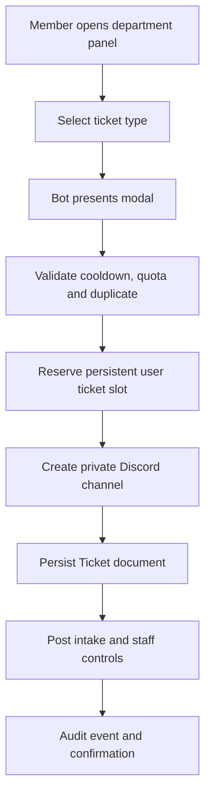
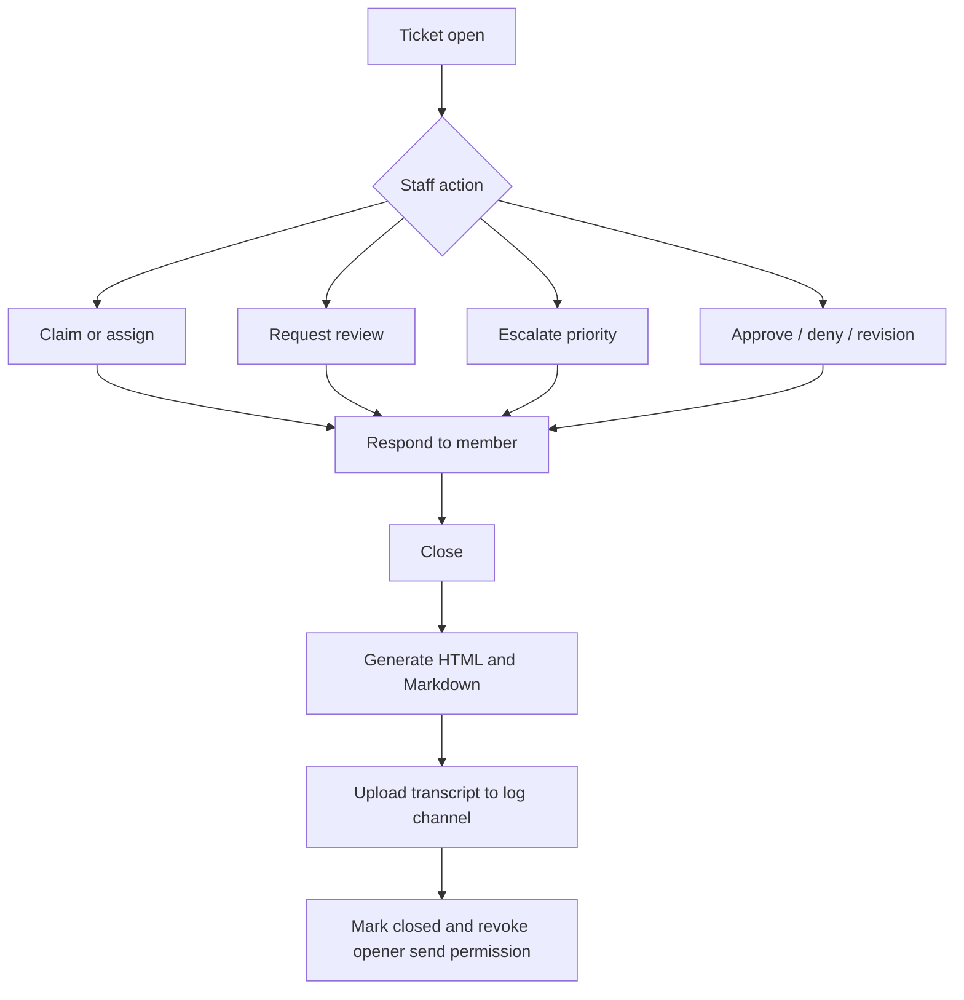

# Ticket Workflows

## Ticket creation

## Staff handling and closure

## Permission model

- @everyone: denied ViewChannel.
- Ticket opener: ViewChannel, SendMessages, ReadMessageHistory, AttachFiles, EmbedLinks.
- Configured department role: ViewChannel, SendMessages, ReadMessageHistory, AttachFiles.
- Assigned staff: explicit channel overwrite.
- Bot: ViewChannel, SendMessages, ReadMessageHistory, ManageChannels, AttachFiles.
- Discord administrators retain platform-level administrator bypass.
